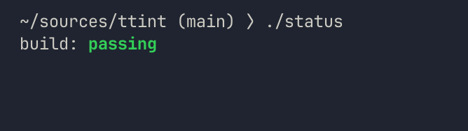
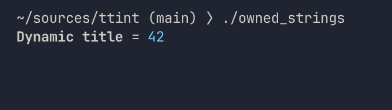
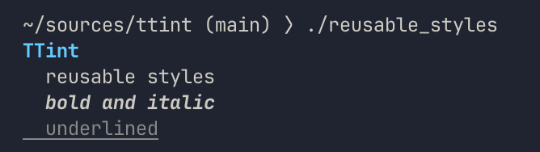
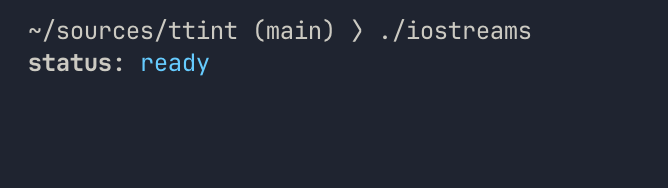
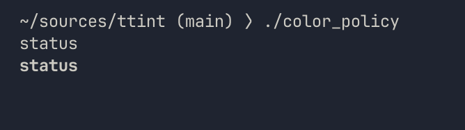
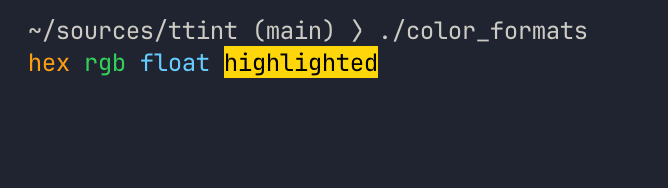
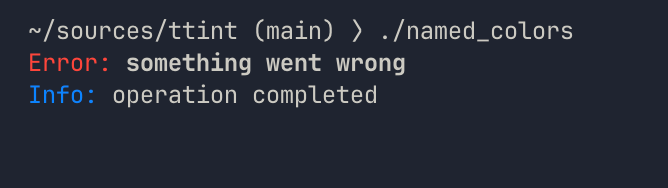

# TTint (Terminal Tint)

**TTint** is a tiny, header-only C++20 library for styling terminal output. It provides a simple API for composing styled text, emits 24-bit ANSI truecolor, and handles terminal detection so output remains readable when redirected.

## Examples

Styles compose with `operator|`, and string literals can become styled segments directly. This composition style is inspired by [FTXUI](https://github.com/ArthurSonzogni/ftxui). TTint applies that idea to focused text styling rather than full terminal UI layout:

```cpp example=status.cpp
#include <TTint/TextStyle.hpp>

int main() {
    // A Segment is text plus a Style. A bare string literal is not a Segment, so use plain() for unstyled text.
    constexpr ttint::Segment status[] = {
            ttint::plain("build: "),
            // `|` between styles merges them; `|` between text and a style builds a Segment.
            "passing" | (ttint::bold() | ttint::fg(0x30d158)),
            ttint::plain("\n"),
    };

    // Writes to stdout and emits only the style changes between segments, then a reset.
    ttint::render_ansi(status);
}
```



The same API works with owned runtime strings:

```cpp example=owned_strings.cpp
#include <TTint/TextStyle.hpp>

#include <string>
#include <utility>

int main() {
    std::string label = "Dynamic title";
    std::string value = "42";

    // Moving a std::string into a Segment makes the Segment own the text. String literals and
    // plain(std::string_view) only borrow, so their source must outlive the Segment.
    const ttint::Segment segments[] = {
            std::move(label) | ttint::bold(),
            ttint::plain(" = "),
            std::move(value) | ttint::fg(0x66ccff),
            ttint::plain("\n"),
    };

    ttint::render_ansi(segments);
}
```



## Why TTint?

- Header-only and easy to embed in an existing C++20 project.
- Compile-time-friendly segments for fixed messages, plus owned strings for runtime content.
- Composable `bold`, `italic`, `underline`, foreground, and background styles.
- 24-bit truecolor using either packed RGB values, normalized floats, or explicit `Color` values.
- ANSI output optimized to emit only the style changes between segments.
- Automatic, always-on, or never-on color policies, with `NO_COLOR` respected in every mode.
- Stdio and iostream integrations, including direct rendering to an `std::ostream` without mixing buffered I/O layers.

## API examples

### Reusable and chained styles

```cpp example=reusable_styles.cpp
#include <TTint/TextStyle.hpp>

using ttint::Segment;
using ttint::Style;

// Style builders are constexpr, so a composed Style can be named once and reused.
constexpr Style heading = ttint::bold() | ttint::fg(0x66ccff);
constexpr Style emphasis = ttint::bold() | ttint::italic();

constexpr Segment message[] = {
        "TTint\n" | heading,
        ttint::plain("  reusable styles\n"),
        "  bold and italic\n" | emphasis,
        // Styles can also be composed inline. Boolean flags are ORed; a later color replaces an earlier one.
        "  underlined\n" | (ttint::underline() | ttint::fg(0x888888)),
};

int main() {
    ttint::render_ansi(message);
}
```



### IO Streams

Include `OStreamStyle.hpp` when the surrounding application uses iostreams:

```cpp example=iostreams.cpp
// OStreamStyle.hpp includes TextStyle.hpp and adds the std::ostream overloads.
#include <TTint/OStreamStyle.hpp>

#include <iostream>

int main() {
    const ttint::Segment segments[] = {
            "status: " | ttint::bold(),
            "ready\n" | ttint::fg(0x66ccff),
    };

    // Writes through std::cout's own buffer, so it is safe to mix with other cout output.
    // The stdio overload render_ansi(segments) writes to stdout directly and should not be mixed with it.
    ttint::render_ansi(std::cout, segments);
}
```



The ostream overload keeps all fragments in the selected stream's buffer. It also applies the stream-aware TTY and `NO_COLOR` policy. For individual values, use `ttint::with_policy(style, policy)`, which returns a `ttint::StyleWithPolicy` for stream insertion, or `ttint::reset(stream, policy)`. To style a single piece of text, render a one-element `Segment` array with `ttint::render_ansi(stream, segments, policy)`.

### Explicit color policy

Rendering APIs accept `ttint::ColorPolicy` per operation:

- `Automatic` is the default. It emits ANSI for confirmed TTY `FILE*` streams; `std::cout` maps to stdout, and `std::cerr`/`std::clog` map to stderr.
- `Always` emits ANSI even for redirected output, unless `NO_COLOR` is set.
- `Never` always emits plain text.

```cpp example=color_policy.cpp
#include <TTint/TextStyle.hpp>

int main() {
    const ttint::Segment segments[] = {"status\n" | ttint::bold()};

    // Never prints plain text, regardless of the destination.
    ttint::render_ansi(stdout, segments, ttint::ColorPolicy::Never);

    // Always emits ANSI even when redirected, unless NO_COLOR is set (it overrides every policy).
    ttint::render_ansi(stdout, segments, ttint::ColorPolicy::Always);

    // Omitting the policy means Automatic: ANSI only for a TTY, and never when NO_COLOR is set.
}
```



`NO_COLOR` has final precedence and suppresses ANSI output for every policy. This makes existing calls safe to adopt incrementally while still allowing a caller to choose the behavior for a particular destination.

### Color formats

`fg()` and `bg()` accept packed hex, explicit `Color` values, or normalized floats:

```cpp example=color_formats.cpp
#include <TTint/TextStyle.hpp>

int main() {
    // Every color form is constexpr, so the whole array can be too.
    constexpr ttint::Segment segments[] = {
            // Packed 0xRRGGBB hex.
            "hex " | ttint::fg(0xff9f0a),
            // Explicit 8-bit channels (0-255).
            "rgb " | ttint::fg(ttint::Color{0x30, 0xd1, 0x58}),
            // Normalized floats (0.0-1.0), rounded to 8 bits.
            "float " | ttint::fg(0.4f, 0.8f, 1.0f),
            // bg() takes the same three forms and composes with fg().
            "highlighted" | (ttint::fg(0.0f, 0.0f, 0.0f) | ttint::bg(0xffd60a)),
            ttint::plain("\n"),
    };

    ttint::render_ansi(segments);
}
```



### Named colors

`Palettes/AppleHig.hpp` provides light and dark variants of the [Apple HIG palette](https://developer.apple.com/design/human-interface-guidelines/color#Specifications):

```cpp example=named_colors.cpp
#include <TTint/Palettes/AppleHig.hpp>
#include <TTint/TextStyle.hpp>

namespace hig = ttint::palette::apple_hig;

int main() {
    // TTint does not detect the OS appearance, so the theme is always chosen explicitly.
    constexpr auto theme = hig::Theme::Dark;
    constexpr ttint::Segment message[] = {
            // hig::red(theme) returns a Color, which fg() accepts like any other.
            "Error: " | ttint::fg(hig::red(theme)),
            "something went wrong\n" | ttint::bold(),
            "Info: " | ttint::fg(hig::blue(theme)),
            ttint::plain("operation completed\n"),
    };

    ttint::render_ansi(message);
}
```



**Note**: TTint does not detect the operating system appearance mode; choose a theme explicitly to keep the library stateless and composable.

### Palettes

A palette is just a namespace of `constexpr ttint::Color` constants, so you can define your own in your project and use it the same way. Optional example headers live under `TTint/Palettes/`, each in `ttint::palette::<name>`, and their constants work anywhere `fg()` and `bg()` accept a `Color`. The bundled palettes are examples of the pattern, not a fixed or exclusive set.

```text
#include <TTint/Palettes/Curiosities.hpp>
#include <TTint/Palettes/Pico8.hpp>

using namespace ttint;

"Hello" | fg(palette::curiosities::pink)
"Error" | fg(palette::pico8::red)
```

Defining your own takes no registration or base type:

```text
namespace brand {
inline constexpr ttint::Color accent = {0x66, 0xCC, 0xFF};
}

"Hi" | ttint::fg(brand::accent)
```

| Header | Namespace | Contents | Source |
| --- | --- | --- | --- |
| `Palettes/AppleHig.hpp` | `palette::apple_hig` | 12 hues and 6 grays, light and dark variants | [Apple Human Interface Guidelines](https://developer.apple.com/design/human-interface-guidelines/color#Specifications) |
| `Palettes/Pico8.hpp` | `palette::pico8` | the 16 default PICO-8 colors | [PICO-8](https://www.lexaloffle.com/pico-8.php) by Lexaloffle Games |
| `Palettes/Curiosities.hpp` | `palette::curiosities` | 6 colors | ["curiosities"](https://lospec.com/palette-list/curiosities) by sukinapan on Lospec |
| `Palettes/Ansi16.hpp` | `palette::ansi16` | the classic 16 terminal colors, `black` to `bright_white` | [IBM VGA text-mode defaults](https://en.wikipedia.org/wiki/ANSI_escape_code#3-bit_and_4-bit) |

`ansi16` holds fixed RGB values, not your terminal theme: terminals remap those slots, so `fg(palette::ansi16::red)` emits a 24-bit color and does not follow the terminal's own red. Color values are factual data; the palette names and values are credited to their sources, and TTint is not endorsed by them.

## Installation and build

### Header-only install

Copy the `include/TTint` folder into your project and add `include/` to your include path. TTint requires C++20.

### CMake

TTint requires CMake 3.21 or newer. A default configure builds the library target without downloading test dependencies or building development examples:

```bash
cmake -S . -B build
cmake --build build
```

Development targets are opt-in and independent:

```bash
cmake -S . -B build-dev -DTTINT_BUILD_TESTS=ON -DTTINT_BUILD_EXAMPLES=ON
cmake --build build-dev
ctest --test-dir build-dev --output-on-failure
```

`TTINT_BUILD_TESTS` and `TTINT_BUILD_EXAMPLES` both default to `OFF`. Enabling tests fetches the pinned doctest revision; enabling examples builds the sample executables and installs them with the `examples` component.

Consumers adding TTint as a subdirectory can link the `TTint::ttint` target without automatically building development targets:

```cmake
add_subdirectory(path/to/ttint)
target_link_libraries(my_app PRIVATE TTint::ttint)
```

The initial package version is `1.0.0`. To install the library and its CMake package files:

```bash
cmake --install build --prefix /path/to/prefix
```

An installed consumer can discover TTint without source-tree include paths:

```cmake
find_package(TTint 1.0.0 CONFIG REQUIRED)
target_link_libraries(my_app PRIVATE TTint::ttint)
```

The package installs headers under `include/`, CMake files under `lib/cmake/TTint/` (or the platform's CMake library directory), and the MIT license under `share/licenses/TTint/`.

## Output and platform notes

`render_ansi(segments)` writes through stdio to `stdout`. If the surrounding application uses `std::cout` or `std::cerr`, do not mix the two buffered I/O layers without flushing; use `to_ansi_string`/`reset_string`, or include `TTint/OStreamStyle.hpp` and call `render_ansi(stream, segments)` instead.

TTint emits ANSI escape codes for 24-bit truecolor (SGR 38;2 and 48;2). Modern Linux, macOS, Windows Terminal, WSL, VS Code terminals, and JetBrains terminals support it. Windows legacy consoles may require `ENABLE_VIRTUAL_TERMINAL_PROCESSING`; SSH and tmux sessions should advertise a 24-bit-capable `TERM` such as `xterm-256color`.

In `Automatic` mode, color is disabled for redirected output and whenever `NO_COLOR` is set. Arbitrary ostreams have unknown terminal status and retain the color-enabled behavior so they can be assembled for a terminal later.

## Repository layout

- `include/TTint/` — public headers
- `examples/` — runnable samples; every README code block has a matching file here, verified by `scripts/check_readme_examples.py`
- `tests/` — doctest test suite
- `docs/` — contributor reference ([C++ style guide](docs/STYLE_GUIDE.md))

## Contributing

See [`docs/STYLE_GUIDE.md`](docs/STYLE_GUIDE.md) for naming, header-only layout, the fluent `operator|` API, tests, formatting (`.clang-format` is authoritative), and the PR review checklist. Build, test and check a change with:

```bash
cmake -B build -DTTINT_BUILD_TESTS=ON
cmake --build build
ctest --test-dir build --output-on-failure
scripts/check_style.py all
```

## License

TTint is licensed under the MIT License. See [LICENSE](LICENSE).
